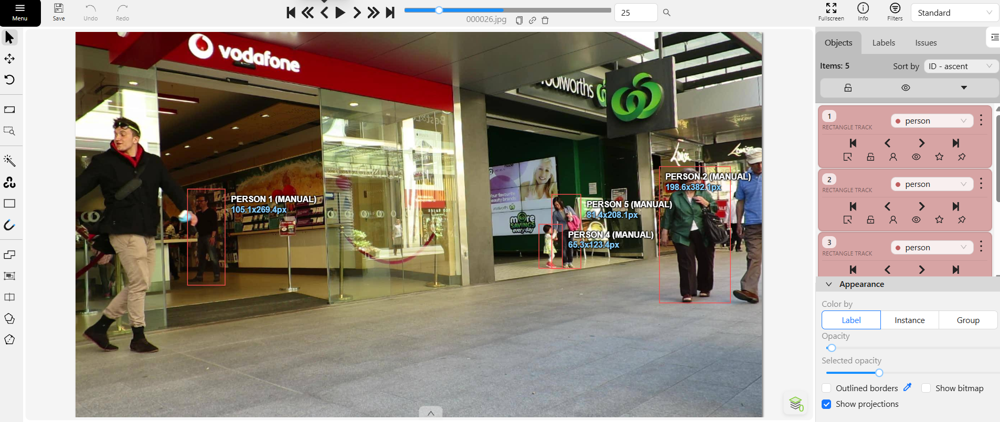
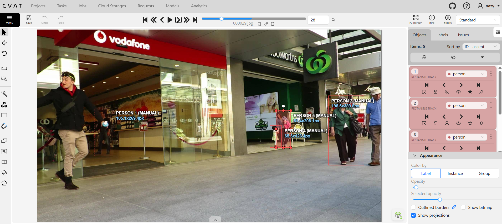
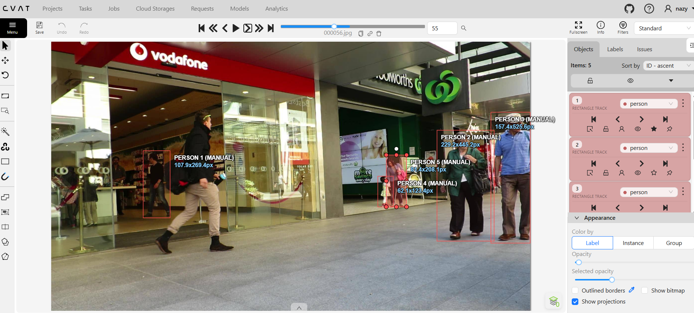

# Báo cáo cá nhân — Nguyễn Văn Hòa — 2A202603139

Đoạn video: MOT17-09, 150 frame (frame 1–150), nguồn MOTChallenge, giấy phép CC BY-NC-SA 3.0.

## 0. Thông tin học viên

- Họ tên: Nguyễn Văn Hòa
- MSSV: 2A202603139
- Mã đề (A/B/C): B
- Email: hoanv0300@gmail.com
- Link repository: https://github.com/Nazylo123/K5-L2-DAY05-NguyenVanHoa-2A202603139-MOTTracking
- Giờ bắt đầu: khoảng 16:30
- Giờ kết thúc: khoảng 18:00

## 1. Xem trước đoạn video (CP0)

Các mốc dưới đây được đối chiếu lại từ bản xuất CVAT. Số frame bắt đầu từ 0. Cột xuất hiện ghi frame đầu tiên có box trong bản xuất.

| Mã | Frame xuất hiện | Frame cuối thấy được | Rẽ / dừng / đổi tốc độ ở frame | Bị che ở frame | Ghi chú |
|---|---|---|---|---|---|
| P1 | 0 | 149 | Dịch sang phải trong cửa hàng, thấy rõ ở frame 25 và 55. | 28–54 | Track CVAT 0 |
| P2 | 0 | 149 | Đi về phía camera, box lớn dần. | Không gắn cờ | Track CVAT 1 |
| P3 | 30 | 149 | Đi về phía camera từ mép phải. | Không gắn cờ | Track CVAT 2 |
| P4 | 0 | 149 | Dịch nhẹ sang phải gần biển quảng cáo. | 110–136, 145–149 | Track CVAT 3 |
| P5 | 0 | 149 | Dịch nhẹ sang phải gần biển quảng cáo. | 103–149 | Track CVAT 4 |

## 2. Keyframe và thời gian (CP1, CP4)

Số keyframe lấy từ kết quả `src/check_submission.py`.

| Mã | Số keyframe | Keyframe ở frame | Số frame có mặt | Keyframe / 100 frame | Thời gian (phút) | Chỗ khó |
|---|---|---|---|---|---|---|
| P1 | 26 | 0, 10, 20, 28, 30, 38, 39, 40, 49, 55, 56, 57, 58, 59, 60, 70, 73, 75, 77, 80, 90, 100, 110, 120, 130, 149 | 150 | 17.3 | 10–15 | — |
| P2 | 65 | 0, 1, 4, 8, 12, 16, 18, 23, 27, 31, 36, 43, 45, 49, 51, 56, 58, 61, 62, 63, 69, 70, 72, 75, 79, 83, 87, 89, 93, 96, 99, 101, 104, 106, 108, 111, 112, 113, 115, 117, 118, 120, 122, 123, 124, 125, 126, 127, 129, 132, 133, 134, 135, 136, 137, 138, 139, 140, 141, 142, 143, 144, 145, 146, 149 | 150 | 43.3 | 10–15 | — |
| P3 | 14 | 30, 40, 50, 60, 70, 80, 90, 100, 110, 120, 129, 130, 140, 149 | 120 | 11.7 | 10–15 | Người lớn tuổi áo xanh, khó nhất khi sát mép phải và tiến gần camera. |
| P4 | 8 | 0, 10, 20, 30, 40, 110, 137, 145 | 150 | 5.3 | 10–15 | — |
| P5 | 9 | 0, 10, 20, 30, 40, 50, 90, 100, 103 | 150 | 6.0 | 10–15 | — |
| **Tổng** | **122** | | **720** | **16,9** | Khoảng 50–75 | |

Keyframe / 100 frame của cả bài = tổng keyframe ÷ tổng số frame có mặt × 100 = 122 ÷ 720 × 100 ≈ 16,9

Bạn đặt keyframe nhiều nhất ở người nào? Vì sao (người đó rẽ, dừng, lại gần camera hay bị che)?

P2 có nhiều keyframe nhất (65). Người này tiến về phía camera, làm kích thước và vị trí box thay đổi rõ qua các mốc quan sát.

## 3. Đoạn bị che (CP2)

Người bị che: `P1` (track 0 trong CVAT).

| Mốc | Frame |
|---|---:|
| Bắt đầu bị che một phần (bật `occluded`) | 28 (cờ occluded bật từ 28 đến 54) |
| Mất hẳn (bật `outside`) | Không có mốc trên track 0 trong bản xuất |
| Hiện lại (tắt `outside`) | Không có mốc trên track 0 trong bản xuất |
| Tắt cờ `occluded` | 55 theo bản xuất |

- Thời gian khuất hẳn: chưa ghi nhận bằng cờ `outside` cho P1.
- Quyết định: giữ cùng ID (track 0 xuyên suốt frame 0–149).
- Lý do: Bản xuất ghi 27 frame bị che một phần, dưới 60 frame. Ảnh frame 25 và 55 cho thấy người mặc áo tối màu vẫn ở khu vực cửa hàng. Vị trí sau đoạn che phù hợp với hướng dịch sang phải, nên giữ cùng ID.

Ảnh chụp màn hình:





## 4. Tự review ID (CP3)

Kết quả tự kiểm do người gán ghi nhận: chưa phát hiện lỗi ID. Checker trên hai ZIP gốc báo 0 lỗi và 0 cảnh báo. Chưa ghi lại kết quả riêng cho từng lượt review.

## 5. File xuất và kết quả tự kiểm (CP4)

| Kiểm tra | Kết quả |
|---|---|
| Tên file MOT 1.1 | NguyenVanHoa_mot.zip |
| Tên file CVAT for video 1.1 | NguyenVanHoa_cvat_video.zip |
| Số track ID khác nhau trong `gt/gt.txt` (phải là 5) | 5 (720 box) |
| Frame `outside` không có dòng trong `gt.txt` (đúng / sai) | Đúng ở mốc kiểm tra: CVAT frame 0 của track 2 có `outside=1`, MOT frame 1 không có dòng ID 5 |
| Job đã completed trên CVAT máy cá nhân | Có, job đã Completed. |

Dán phần tóm tắt in ra từ `src/check_submission.py`:

```text
=== Tóm tắt ===
  Lỗi: 0   |   Cảnh báo: 0
  Đạt. Dán phần tóm tắt này vào báo cáo mục 5.
```

## 6. Ba câu kết

1. Nếu được gán lại, bạn sẽ đặt keyframe khác ở đâu? Vì sao?

   Mình sẽ kiểm tra thêm box của P3 quanh frame 30, khi người áo xanh ở sát mép phải. Nếu box nội suy lệch khi người tiến gần camera, mình sẽ đặt thêm keyframe tại vị trí bắt đầu lệch.

2. Có chỗ nào bạn không chắc "cùng ID hay ID mới"? Bạn đã quyết định và ghi chú thế nào?

   Mình không có đoạn phân vân về ID mới. Ở đoạn P1 bị che một phần, mình giữ ID xuyên suốt.

3. Một lỗi ID trong job của bạn (nếu không còn sót, chọn lỗi đã sửa) có thể làm xe tự lái dự đoán sai chuyển động của người đó như thế nào? Lỗi đó ảnh hưởng MOTA hay IDF1 nhiều hơn?

   Ví dụ, nếu ID của một người bị đổi khi đi qua vùng che, hệ thống có thể mất lịch sử chuyển động và dự đoán sai hướng hoặc thời điểm người đó cắt qua đường. Nếu ID sai kéo dài qua nhiều frame, IDF1 phản ánh rõ sự mất nhất quán đó. MOTA cũng tính sự kiện đổi ID.

## 7. Tài liệu tham khảo và công cụ AI đã dùng

- Hướng dẫn Lab Day 05 và `src/check_submission.py` trong repo.
- ChatGPT (Codex): đọc hai ZIP gốc, tổng hợp số liệu và soạn báo cáo Markdown.

